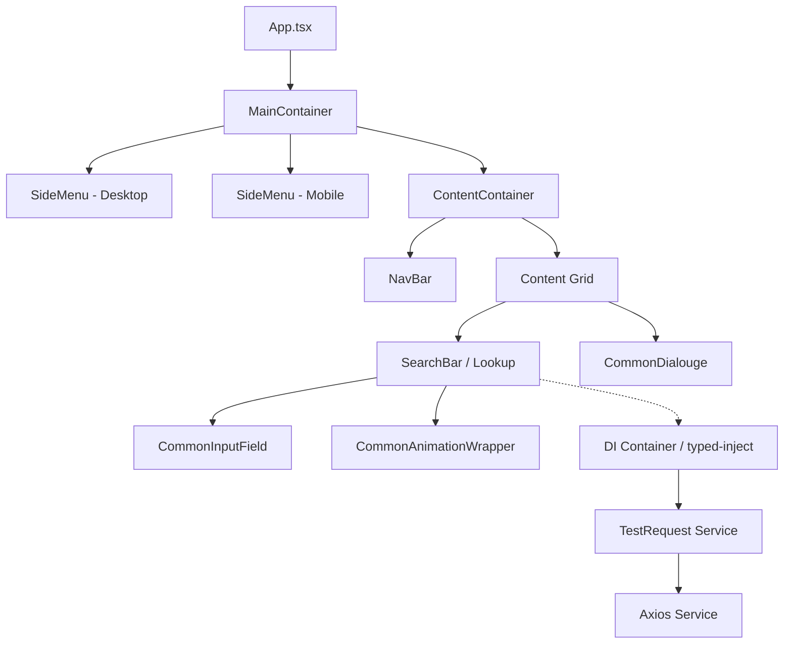

# Architecture & Design System

This document outlines the architectural principles, component hierarchies, responsive strategies, and dependency injection patterns governing this library.

---

## 1. Architectural Philosophy

The library is built around four fundamental principles:

1. **Separation of Presentation and Business Logic**:
   Components focus strictly on user interaction, state reflection, and transitions. All data retrieval, network communications, and domain operations are decoupled into the `Logic/` layer via typed interfaces.
2. **Inversion of Control (IoC) with Type Safety**:
   Services are registered in a centralized Dependency Injection container powered by [`typed-inject`](file:///G:/common-components/common-layout-components/src/DI.ts). Consumers never instantiate concrete HTTP or data clients directly.
3. **Responsive-First Dual-Render Layout**:
   Desktop and mobile drawer navigation are split cleanly to avoid conflicting CSS transforms, using a dual-mount responsive architecture.
4. **Motion-Driven Visual Continuity**:
   All state transitions (drawers, dialogs, dropdowns) are managed through declarative physics animations using `motion/react`.

---

## 2. Directory Structure & Layering

```
src/
├── Logic/                      # Business & Data Layer
│   ├── interfaces/             # TypeScript contracts (ISendRequest, ITestingRequests)
│   └── services/               # Concrete implementations (Axios, TestRequest)
├── Models/                     # Core Domain & Data Transfer Models
│   ├── BaseModel.ts            # Utility types (Dictionary<K, V>)
│   └── CommonModels.ts         # Navigation models (CommonNavaigationLink)
├── side-menu/                  # Side menu subsystem
│   ├── Side-Menu.tsx           # Drawer container & AnimatePresence
│   ├── Side-Menu-Option-Wrapper.tsx  # Recursive sublink & match evaluation
│   └── Side-Menu-Option.tsx    # Interactive link row
├── DI.ts                       # typed-inject container registration
├── Main-Container.tsx          # Root flex container
├── content-container.tsx       # Content area with backdrop dimming
├── nav-bar.tsx                 # Header navigation & drawer trigger
├── common-input-field.tsx      # Polymorphic form input component
├── common-button.tsx           # Button with theme variants
├── common-dialouge.tsx         # Modal dialog overlay
├── search-bar.tsx              # Debounced search & lookup component
├── common-animation-wrapper.tsx# Composable motion wrapper
└── App.tsx                     # Example integration shell
```

---

## 3. High-Level System Architecture



---

## 4. Layout & Responsive Design Pattern

### The Dual-Menu Desktop/Mobile Strategy
In [`App.tsx`](file:///G:/common-components/common-layout-components/src/App.tsx#L31-L64), the application mounts the [`SideMenu`](file:///G:/common-components/common-layout-components/src/side-menu/Side-Menu.tsx) twice using responsive Tailwind utility classes:

1. **Desktop Viewport (`lg:` breakpoint and above)**:
   ```tsx
   <div className="hidden lg:flex lg:w-82">
     <div className="fixed">
       <SideMenu hideSideMenu={false} animated={false} links={...} />
     </div>
   </div>
   ```
   - Persistently rendered as a fixed column.
   - Sizing reservation (`lg:w-82`) prevents content shifts.
   - Animation disabled (`animated={false}`) for instant rendering.

2. **Mobile Viewport (below `lg:`)**:
   ```tsx
   <div className="flex lg:hidden">
     <SideMenu hideSideMenu={hideSideMenu} animated={true} links={...} />
   </div>
   ```
   - Dynamically mounted and unmounted via `AnimatePresence`.
   - Slides from `x: -100%` off-screen.
   - Toggled via the hamburger button in [`NavBar`](file:///G:/common-components/common-layout-components/src/nav-bar.tsx).

### Dimmed Backdrop Interaction
[`ContentContainer`](file:///G:/common-components/common-layout-components/src/content-container.tsx#L16) watches the `hideSideMenu` state:
- When the mobile menu opens (`hideSideMenu === false`), `dimTheLights` evaluates to `true`.
- Applies `bg-black/50` dimming layer on mobile screens.
- Any click on the content area invokes `onClick={() => setHideSideMenu(true)}`, dismissing the drawer.

---

## 5. Overlay Grid Architecture

Modals such as [`CommonDialouge`](file:///G:/common-components/common-layout-components/src/common-dialouge.tsx) are structured to avoid portal fragmentation by utilizing CSS Grid layering:

```html
<div className="grid min-w-0 flex-1 h-full w-full">
  <!-- Content Layer -->
  <div className="row-start-1 col-start-1 h-300 z-10 p-8">
    ... Page components ...
  </div>

  <!-- Modal Backdrop Layer -->
  <div className="row-start-1 col-start-1 bg-black/40 z-10 flex">
    ... Animated Dialog ...
  </div>
</div>
```

Both elements occupy `row-start-1 col-start-1`. When `showDialouge` is toggled:
- Backdrop shifts from `bg-transparent z-0` to `bg-black/40 z-10`.
- Dialog content scales vertically using `scaleY: 0 -> 1`.

---

## 6. Routing Integration Pattern

The navigation components deep-link with `react-router` through two hooks:
- **`useNavigate()`**: Handles route push events when any menu option is clicked.
- **`useMatch(path)`**: Synchronizes menu visuals with URL routing:
  - Exact match (`useMatch(link.url)`) turns active link into inverted highlight (`bg-white text-[#1E104E]`).
  - Sub-route match (`useMatch(`${link.url}/*`)`) automatically expands nested sublink children and points the chevron down (`bx bx-chevron-down`).

---

## 7. Dependency Injection Design Pattern

### Inversion of Control with `typed-inject`
The application implements IoC through `typed-inject` in [`src/DI.ts`](file:///G:/common-components/common-layout-components/src/DI.ts):

```
+-------------------------------------------------------------+
|                      DIcontainer                            |
|                                                             |
|  .provideClass("ISendRequest", Axios)                       |
|  .provideClass("ITestRequest", TestRequest)                 |
+-------------------------------------------------------------+
                 |
                 v
+-------------------------------------------------------------+
|                    TestRequest Class                        |
|                                                             |
|  public static inject = ["ISendRequest"] as const;          |
|  constructor(private sendRequest: ISendRequest) {}          |
+-------------------------------------------------------------+
```

### Advantages
1. **Contract Independence**: Components consume [`ITestingRequests`](file:///G:/common-components/common-layout-components/src/Logic/interfaces/ITestingRequests.ts) without knowing whether underlying transport is `Axios`, `Fetch`, or a mock service.
2. **Deterministic Mocking**: Unit tests can register mock providers into a isolated `createInjector()` instance without modifying React component logic.

---

## 8. Design Tokens & Styling Conventions

### Typography
- Primary font family: `Poppins` (`font-['Poppins']` or `font-[Poppins]`).
- Weight hierarchy: 400 (Regular), 500 (Medium), 600 (SemiBold), 700 (Bold).

### Color Palette
| Token | Hex / Class | Usage |
| :--- | :--- | :--- |
| **Brand Primary** | `#1E104E` | Side menu background, primary button, focus border highlights |
| **Brand Secondary** | `#450693` | Secondary button background, light button text |
| **Danger / Cancel** | `bg-rose-600` | Cancel button actions |
| **Neutral Dark** | `bg-black` | Dark button variant, backdrop scrims (`bg-black/40`, `bg-black/50`) |
| **Background Start**| `#F8FAFC` | Top of vertical linear gradient background |
| **Background End**  | `#EFF6FF` | Bottom of vertical linear gradient background |
| **Border Neutral**  | `border-gray-300`, `border-slate-500` | Input borders, modal containers |

### Iconography
- Library: [Boxicons 2.1.4](https://boxicons.com/).
- Standard icon classes:
  - Navigation: `bx bxs-home`, `bx bx-home-alt`
  - Mobile Menu: `bx bx-menu`
  - Carets: `bx bx-chevron-down`, `bx bx-chevron-right`
  - Functional: `bx bx-search`, `bx bx-x` (close/unlock)
